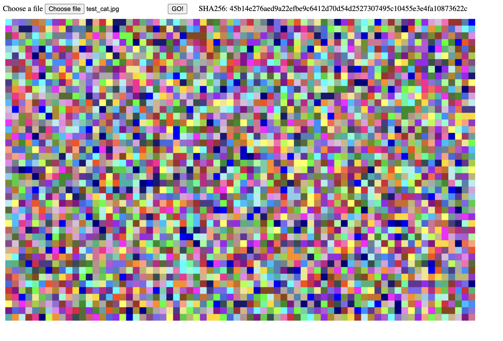

# FlashExfil

## Summary 



This tool is designed to help exfiltration of files from remote desktops which block Copy and Paste or other exfiltration methods. This is achieved by encoding files into a series of colour grids, a Python script can then decode these grids back into the original file from a recording. 

During testing we have achieved a data transfer rate of 50 KB/s during the flashing phase, it is possible to run this tool at a higher rate with higher power machines.

**Note: This tool rapidly flashes coloured squares on a screen, if you suffer from a condition such as epilepsy, this may be unsuitable**

## Usage

### Overview

Typically using this program will consist of the following steps

- Use `typer.py` to type the `flash.html` file into your target machine over RDP or similar
- Use `typer.py` to type the `training.txt` file into your target machine over RDP or similar 
- Use `flash.html` to flash `training.txt` and record it with `collector.py`
- Use `decode.py` in training mode with the recording from `collector.py` and `training_b64.txt` to train `decode.py` 
- Use `flash.html` to flash your target file and record it with `collector.py` 
- Use `decode.py` with the colour mappings from training to decode the new recording from `collector.py`
- You should now have the file exfiled 
- (Optional) Compare the SHA256 hash of the exfiled file with the value shown in `flash.html` to confirm it came out correctly

The examples below use `python3`, on Windows use `python` or `py` instead.

### Typing flash.html 

On your target machine (accessed via RDP, etc) open a text editor such as Notepad, then on your main machine run `typer.py` targeting `flash.html` 

```
$ python3 typer.py -f flash.html
```

You will have a few seconds (specified by the delay parameter, or default of 5) to click back into the text editor and give it focus. If something goes wrong, move the mouse to the top left corner of the screen to stop typing.

Wait until the typer finishes and save `flash.html` as a HTML file (any name is okay)

Plain editors like Notepad work best. Editors that auto-indent or auto-close brackets and tags, such as VSCode or Vim, can change the file as it is typed. If you use one of these, turn those features off first (e.g. `:set paste` in Vim).

### Typing training.txt

On your target machine (accessed via RDP, etc) open a text editor such as Notepad, then on your main machine run `typer.py` targeting `training.txt` 

```
$ python3 typer.py -f training.txt
```

You will have a few seconds (specified by the delay parameter, or default of 5) to click back into the text editor and give it focus.

Wait until the typer finishes and save `training.txt` as a .txt file (any name is okay)

Re-open the saved file, and make sure it is all on one line, some text editors automatically add another line. If this happened, remove the extra line break.

### Keyboard Layouts

`typer.py` presses keys rather than pasting text, so the keyboard layout matters.

On Windows the default mode (`-m keys`) works out the keys to press from your local keyboard layout, so characters like `#` and `"` are typed correctly on UK and US layouts. The remote machine then reads those keys using its own layout, so this works best when both machines use the same layout. If they are different, either switch your local layout to match the remote machine, or try `-m unicode`, which sends the characters themselves and ignores the layout.

```
> python typer.py -f flash.html -m unicode
```

On macOS and Linux typing is done through pyautogui, which assumes a US layout. If the remote machine uses a different layout, switch it to US while typing.

If characters go missing when typing over a slow connection, use `-c` to type in chunks, or add a small interval between key presses with `-i 0.01`.

### Training the Tool

Training is used to ensure the colour matching used by this tool is calibrated, this is important as the compression of RDP and other remote desktop tools can cause variations from the hard-coded values used by default.

Now open `flash.html` in a browser, for testing, I was using Chrome on MacOS. 

Next, use the file selector to select training.txt, the SHA256 hash shown in `flash.html` should update and match the following:

```
8e29cddec596759961a22faeabb170e52bb83a7a9f4947395842b54e88784ed5
```

Next, we setup `collector.py`, ensure you have `flash.html` visible on your screen, the full black box should be visible with nothing overlapping.

```
$ python3 collector.py
```

The screen should dim slightly with a grey overlay. You can now drag and select the area to be recorded. This should be the black box of `flash.html` which indicates where the grids will be displayed. Press `Escape` to cancel.

Click in the top-left of this, then drag to the bottom right, a red rectangle will be displayed showing the area you are selecting.

Once you have the area selected, release the left-mouse button, the output of `collector.py` should now say `Press enter to continue`. When you are ready, focus the terminal and press enter.

You now have 5 seconds (by default, this can be modified) before the recording starts, be ready to click "GO!" in `flash.html`. From this point ensure nothing covers the area you selected for recording, e.g. notifications, your cursor, etc.

Once you see "Started recording" in the terminal, click "GO!", the grid should start flashing colours.

Carefully re-focus the terminal, ensuring nothing overlaps or covers the grid. 

You must now wait until the grid turns entirely white, indicating it has finished. At this point press `Ctrl-C` to stop the recording. The collector will print how many frames it recorded and the average FPS it managed.

The next step is to take the recording and use it to train the tool. 

```
$ python3 decode.py -t -r canvas_recording.mp4 -b64 training_b64.txt
```

You should see an output similar to the below:

```
[+] Extracting frames from video
[+] Detected first grid at frame 82
[+] Detected end grid at frame 113
[+] Found 5 grids after skipping 81 white frames
[+] Total grids matches expected of: 5
[+] Length of trained data matches known base64
[+] Learned colors for 65 characters
[+] Training complete
```

Importantly, you are looking for 

```
[+] Learned colors for 65 characters
```

If this value is not 65, an error may have occurred. 

**Note: You should re-train for each RDP (or other remote desktop tool) you use, as the compression may change**

### Extracting a Real File

Assuming the training was successful, we are now able to extract real files. The flash and recording process is the same as for training, merely select the file you wish to exfil, record and flash it. 

Once you have a recording of a file you wish to decode, you can do so using the following command (Adjust the parameters as required)

```
$ python3 decode.py -r canvas_recording.mp4 -o out.jpg -cm color_mapping.json
```

You should see an output similar to the below 

```
[+] Loaded 65 color to character mappings
[+] Decoding video
[+] Detected first grid at frame 63
[+] Detected end grid at frame 1041
[+] Found 163 grids after skipping 62 white frames
[+] Processed 100 of 163 grids
[+] Total file size: 383568 bytes
[+] SHA256 hash of decoded file: 45b14e276aed9a22efbe9c6412d70d54d2527307495c10455e3e4fa10873622c
[+] Decoded file to out.jpg
```

Assuming the SHA256 displayed in the output matches the SHA256 shown in `flash.html`, you should now have the exfiled file. 

If the decoder reports missed grids, the recording did not capture every grid. Increase the "Delay (ms)" value in `flash.html` or record at a higher FPS and try again. Running with `-d` shows how many frames were captured for each grid.

### Help 

#### collector.py

```
$ python3 collector.py -h
usage: collector.py [-h] [-o OUTPUT] [-fps RECORDING_FPS] [-d DELAY]

options:
  -h, --help            show this help message and exit
  -o, --output OUTPUT   Path to save output file (Default = canvas_recording.mp4)
  -fps, --recording-fps RECORDING_FPS
                        Target FPS for recording (Default = 120)
  -d, --delay DELAY     Delay before recording starts in seconds (Default = 5, Minimum = 1)
```

#### decode.py

```
$ python3 decode.py -h
usage: decode.py [-h] -r RECORDING [-t] [-b64 BASE64] [-cm COLOR_MAPPINGS] [-dm] [-o OUTPUT] [-d]

options:
  -h, --help            show this help message and exit
  -r, --recording RECORDING
                        Path to recording of flashes
  -t, --train           Training mode
  -b64, --base64 BASE64
                        Path to known base64 for training
  -cm, --color-mappings COLOR_MAPPINGS
                        Path to save or load color mappings, default=color_mapping.json
  -dm, --use-default-mappings
                        Use default color mappings instead of trained file (decode mode only)
  -o, --output OUTPUT   Path to save output file
  -d, --debug           Print debug messages
```

#### typer.py

```
$ python3 typer.py -h
usage: typer.py [-h] -f FILE [-c] [-cs CHUNK_SIZE] [-d DELAY] [-i INTERVAL] [-m MODE]

options:
  -h, --help            show this help message and exit
  -f, --file FILE       Input file to type
  -c, --chunk           Chunk typing file content, for use if typing large files
  -cs, --chunk-size CHUNK_SIZE
                        Number of characters per chunk for use with --chunk (Default = 100, Minimum = 1)
  -d, --delay DELAY     Delay before typing starts in seconds (Default = 5, Minimum = 1)
  -i, --interval INTERVAL
                        Interval between key presses (Default = 0, Minimum = 0)
  -m, --mode MODE       Windows only, keys sends key presses for the local keyboard layout, unicode sends characters directly (Default = keys)
```

## Installation

This tool was originally tested on MacOS 26 using Python 3.14.0, and is written to run on Windows, MacOS and Linux. Install the required Python modules with pip:

```
$ python3 -m pip install -r requirements.txt
```

This installs mss, imageio with its bundled ffmpeg, numpy, pillow and (on MacOS and Linux) pyautogui. OpenCV is no longer needed.

`collector.py` also needs tkinter, which comes with Python on Windows and with the python.org installers on MacOS. Other setups may need it installed separately.

### Windows

- Use `python` or `py` in place of `python3`
- Display scaling (125%, 150%, etc) is handled by `collector.py`, the selected region will match what is recorded

### MacOS

- The terminal you run the scripts from needs Screen Recording permission for `collector.py` and Accessibility permission for `typer.py` (System Settings > Privacy & Security)
- If you use Homebrew Python, install the tkinter package matching your Python version, e.g. `brew install python-tk@3.14` for Python 3.14 (check with `python3 --version`)

### Linux

- Use an X11 session, screen capture and typing do not work under Wayland
- Install tkinter with your package manager, e.g. `sudo apt install python3-tk`
- The selection overlay is see-through only when a compositor is running, which is the default on most desktops

## Files in Project

### collector.py

This script allows specifying an area of the screen to record and is used to record the flashing grids for later decoding.

Recordings are saved as lossless H.264 (4:4:4) so no colour detail is lost. Many built-in video players, such as Windows Media Player and QuickTime, cannot play this format. This does not affect decoding, but if you want to watch a recording use VLC or ffplay.

### decode.py

This script processes the recordings generated by the collector script. First allowing training of the color model, then decoding the flashes back into files.

### typer.py

This script allows the user to "type" the contents of files automatically, and is designed to allow you to load the training file and flash HTML into a remote machine that does not allow copy and paste.

### flash.html

This HTML file allows the user to select files, it will then base64 encode them and display them as a series of coloured flashing grids for later decoding.

The top left and bottom right squares of each grid are markers that cycle through red, green and blue. The decoder uses them to tell one grid from the next, even when two grids hold the same data, and to spot any grids missing from a recording. When both markers are white the grid is blank, which marks the start and end of a transfer.

### training.txt

A plaintext file with known base64 to train the decoder. 

### training_b64.txt

The known base64 for training.txt used to train the decoder.

### test_cat.jpg

An extra file to test the tool with. 

### requirements.txt

The Python modules needed to run the tool.

## Limitations and Tweaks

- Each grid is displayed for 50ms by default, this can be changed with the "Delay (ms)" box in `flash.html`. If grids are being missed, increase the delay
- The recording FPS should be at least 3 times the number of grids shown per second, at the default 50ms delay that is 60 FPS, the collector records at 120 FPS by default. Check the average FPS the collector prints when it stops, slower machines may not reach the target
- The delay is measured in time rather than frames, so high refresh rate monitors no longer change how long each grid is shown
- If you make a new training file, with the known base64 ensure there is no extra newline in the file, it should all be on one line
- Recordings made with older versions of `flash.html` cannot be decoded by this version of `decode.py`, existing colour mapping files still work

## Upcoming 

An alternative version of this tool that encodes grids of QR codes to allow a higher data transfer rate will be released in the near future. 

## Disclaimer

This tool is provided for educational purposes, or for use by security testers during their authorised engagements. Use of this tool in unauthorised environments, or to exfiltrate data without authorisation is strictly forbidden.

I can accept no responsibility for unauthorised use of this tool. 

This tool is provided without warranty or guarantee.
